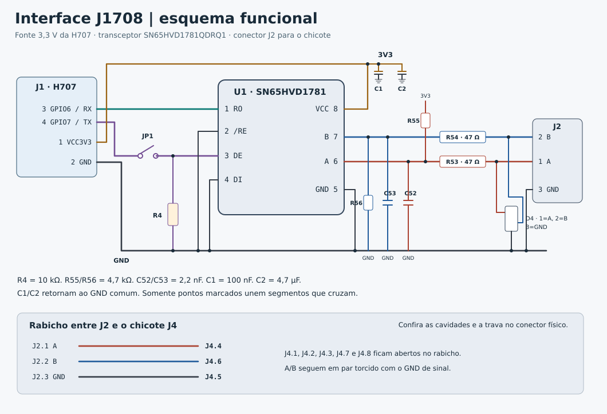

# Interface J1708/J1587

U1 é o SN65HVD1781QDRQ1 em SOIC-8, montado em adaptador comercial SOIC-8/DIP-8 de 7,62 mm entre fileiras. O SOIC e o adaptador têm pino 1 no extremo da marca. O valor de referência segue a Rev.B.1 onde a função coincide. O U1 da Rev.C corresponde ao **U4** da doadora.

| U1 | Sinal TI | Ligação na Rev.C |
|---:|---|---|
| 1 | R/RO | J1.3 → U5.11 da H707 → GPIO6, UART2 RX sem inversão |
| 2 | /RE | GND, receptor habilitado inclusive durante TX |
| 3 | DE | R4 de 10 kΩ a GND e JP1 em série com J1.4 → U5.10 → GPIO7 |
| 4 | D/DI | GND, fixa o bit dominante do driver |
| 5 | GND | GND comum da H707 e do adaptador do chicote |
| 6 | A | A_INT, lado interno de R53 |
| 7 | B | B_INT, lado interno de R54 |
| 8 | VCC | J1.1 → U5.16, VCC3V3. C1 100 nF e C2 4,7 µF em paralelo para GND |

| Peça | De | Para |
|---|---|---|
| R53 47 Ω | A_INT | A_BUS → J2.1 |
| R54 47 Ω | B_INT | B_BUS → J2.2 |
| R55 4,7 kΩ | A_INT | VCC3V3 |
| R56 4,7 kΩ | B_INT | GND |
| C52 2,2 nF | A_INT | GND |
| C53 2,2 nF | B_INT | GND |
| D4 ESD2CAN24DCKRQ1 | Pino 1 em A_BUS e pino 2 em B_BUS | Pino 3 em GND, retorno curto a J2.3 |
| J1.2 | U5.15 da H707 | GND |
| J2.3 | Retorno do chicote | GND |

**JP1 começa aberto.** R4 mantém DE baixo com J1 solto, GPIO em alta impedância ou reset. JP1 fechado é reservado ao ensaio ativo em bancada isolada e à configuração de veículo que já passou por esse ensaio. Aperte o shunt de retenção ou use ponte isolada soldada após a liberação. O build passivo também mantém GPIO7 fora da rota TX da UART.

## Estados e níveis

Use `Vdiff = VA − VB` na interpretação da tabela e no osciloscópio. O nome A/B do conector do Volvo deve ser confirmado por continuidade e forma de onda na instalação concreta.

| Condição | TX lógico | GPIO7 com TX invertido | Driver | Vdiff | RO esperado |
|---|---:|---:|---|---|---:|
| Reset, JP1 aberto ou UART ociosa | 1 ou alta impedância | 0 ou desabilitado | A/B em alta impedância | Recessivo. A polarização tende a VA > VB | 1 |
| Bit 0 e start bit | 0 | 1 | DI baixo impõe A baixo e B alto | Negativo, dominante | 0 |
| Bit 1 e stop bit | 1 | 0 | A/B em alta impedância | Recessivo. Outro nó pode impor dominante | 1 em repouso |

O datasheet TI especifica VCC de 3,15 a 5,5 V, VIH mínimo de 2 V e VIL máximo de 0,8 V para as entradas de controle. Com VCC em 3,3 V, o domínio de RO é compatível com a H707. Use o próprio VCC3V3 para alimentar U1 e medir entre U1.8 e U1.5. Em condição de teste do TI com 54 Ω e VCC de 3,15 a 3,45 V, o mínimo de |VOD| é **0,8 V no CI**. O valor não prevê o nível depois dos dois resistores em série e do chicote. Como critério de projeto inicial, medir no J2 |Vdiff| ≥ 0,4 V no dominante, pelo menos duas vezes o limite de decisão de 200 mV do receptor. Confirmar margens, modo comum e bordas no ensaio com carga e na SAE J1708 aplicável antes de liberar uso ativo. [Datasheet TI SN65HVD178x-Q1, §§5.4, 5.6 e 7.4](https://www.ti.com/lit/ds/symlink/sn65hvd1781-q1.pdf)

Os resistores de 4,7 kΩ formam um caminho diferencial nominal de aproximadamente 9,5 kΩ por nó pela polarização e pelos 47 Ω, com os capacitores em circuito aberto em regime DC. A polarização própria em repouso implica cerca de 0,35 mA se o par for curto-circuitado, antes das outras cargas. C52/C53 são shunts de modo comum do lado do CI. O produto isolado 47 Ω × 2,2 nF é 103 ns e não representa a constante do chicote inteiro. Monte sem resistência de terminação de 120 Ω e sem alterar as cargas dos outros nós. Meça o efeito da Rev.C energizada e desligada. [Topologia Rev.B](https://github.com/rbasniak1989-lab/Truckbox/blob/1c0bb007f711a997096e1d5959a1c6e30a833dd7/hardware/reva/apply_revb_j1708.py) · [SAE J1708_201609](https://doi.org/10.4271/J1708_201609)

D4 é um supressor bipolar de dois canais com terra comum, separado do caminho série. O ESD2CAN24-Q1 tem janela de ±24 V e clamp típico de 37 V no ensaio de 5,7 A com pulso de 8/20 µs. Mantenha os fios ao J2 curtos e próximos entre si. Verifique a corrente de retorno e os transientes no conjunto. A faixa de falha dos pinos A/B do HVD1781 e a classificação do D4 descrevem os componentes. A montagem manual ainda precisa de ensaio de proteção e EMC para uso no veículo. [Datasheet TI ESD2CAN24-Q1, §§4 e 5](https://www.ti.com/lit/ds/symlink/esd2can24-q1.pdf)

## Conexão do caminhão

| Perfurada | Sinal | Chicote no lado J4 da Rev.B.1 |
|---|---|---:|
| J2.1 | A_BUS | 4 |
| J2.2 | B_BUS | 6 |
| J2.3 | GND de sinal | 5 |

O conector J4 da Rev.B.1 é Mini-Fit/MX de 8 vias, passo 4,2 mm. Identifique as cavidades pelos números gravados e confira a orientação pelo lado da trava. Confeccione o rabicho de adaptação com terminais nas três cavidades do mapa. Nas demais cavidades, deixe os contatos ausentes no rabicho ou isolados individualmente. J4.7 pode ter alimentação permanente e J4.3 pode ter ACC. Confira continuidade terminal a terminal com a ignição desligada e verifique as tensões no chicote solto antes de acoplar J2. Mantenha A/B torcidos e o GND de referência acompanhando o par. [Fonte do J4](https://github.com/rbasniak1989-lab/Truckbox/blob/1c0bb007f711a997096e1d5959a1c6e30a833dd7/hardware/reva/apply_revb_vehicle_connector.py)

A UART utiliza 9.600 bit/s, 8N1, 104,17 µs por bit e cerca de 1,042 ms por caractere. A guarda de TX observa arestas RX, nível ocioso, FIFO e fila. Cada byte retorna pelo RO e é comparado. Eco divergente pode interromper TX, mas duas transmissões com bytes idênticos não são distinguíveis pelo eco. Consulte a [sequência de ensaios](TESTES_J1708.md).
