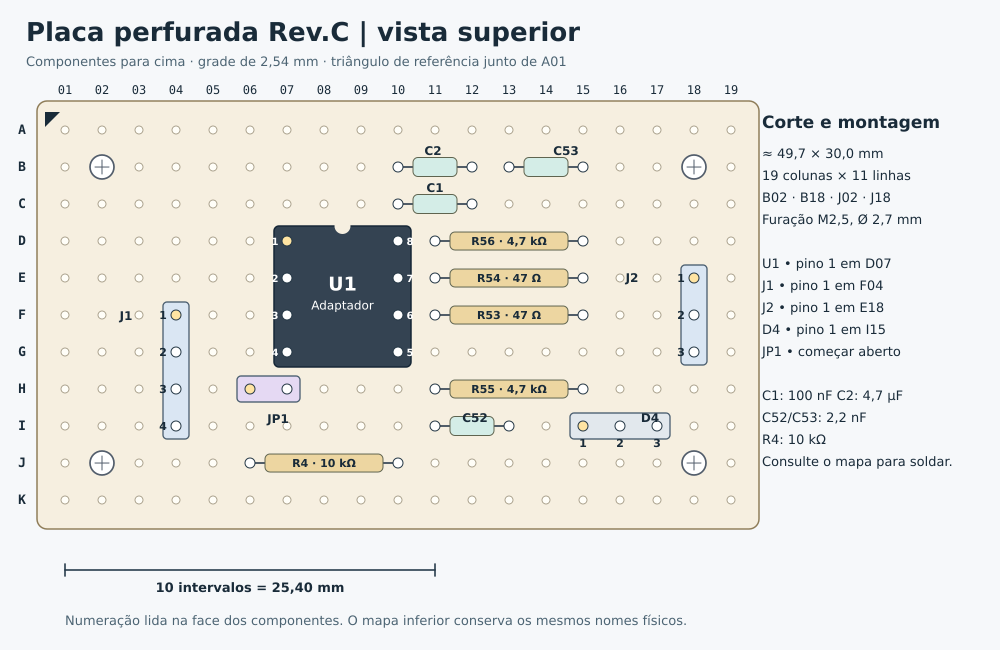
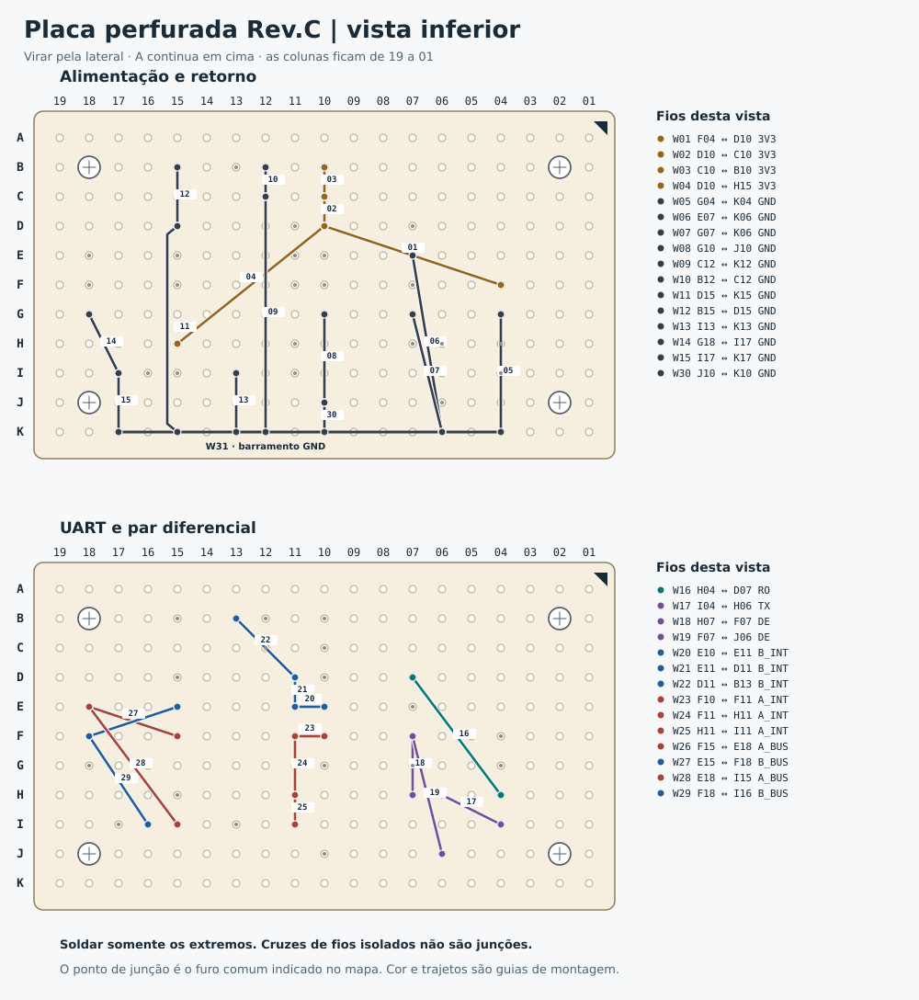

# Mapa da placa perfurada

Use FR4 de 1,6 mm com ilhas individuais. Corte uma área com 19 colunas por 11 linhas de furos, passo 2,54 mm. A área sugerida é 49,7 × 30,0 mm. A distância entre centros extremos é 45,72 × 25,40 mm. Deixe cerca de 2,0 mm de margem nos extremos longos e 2,3 mm nas laterais. Marque o canto A01 com triângulo permanente. Em vista de cima A01 fica à esquerda. Ao virar pela lateral, A01 aparece à direita e a linha A continua em cima.

Fure B02, B18, J02 e J18 para M2,5 com broca de 2,7 mm. Remova rebarbas e anéis de cobre soltos. As distâncias entre centros são 40,64 × 20,32 mm. Preserve folga nas arruelas. Lave a placa e teste a ausência de limalhas antes de montar.

## Terminais por furo

| Peça | Furo por terminal na vista superior |
|---|---|
| J1 | 1 em F04 (3V3), 2 em G04 (GND), 3 em H04 (RO), 4 em I04 (TX) |
| J2 | 1 em E18 (A), 2 em F18 (B), 3 em G18 (GND) |
| U1 | 1 em D07, 2 em E07, 3 em F07, 4 em G07, 5 em G10, 6 em F10, 7 em E10, 8 em D10 |
| JP1 | 1 em H06 (TX), 2 em H07 (DE). Aberto para RX |
| R4 10 kΩ | J06–J10 |
| R53 47 Ω | F11–F15 |
| R54 47 Ω | E11–E15 |
| R55 4,7 kΩ | H11–H15 |
| R56 4,7 kΩ | D11–D15 |
| C1 100 nF | C10–C12 |
| C2 4,7 µF | B10–B12. Use cerâmico sem polaridade |
| C52 2,2 nF | I11–I13 |
| C53 2,2 nF | B13–B15 |
| D4 | 1 em I15 (A), 2 em I16 (B), 3 em I17 (GND) via adaptador SC70-3 de pinagem conferida |

Os terminais U1 são numerados no sentido anti-horário visto de cima, começando em D07. O entalhe do adaptador DIP fica voltado para a linha C. Confira continuidade do ponto de pino 1 no SOIC até D07 antes de soldar as oito pernas do adaptador. Intercale no máximo a altura dos soquetes exigida pelo encapsulamento. Soldar diretamente o adaptador evita folga sob vibração. Use resistores axiais compactos de corpo até aproximadamente 2,4 mm ou monte corpos de fileiras adjacentes com pequeno desnível. C1/C2/C52/C53 têm 5,08 mm entre furos. Para o D4, use adaptador DCK/SC70-3 comercial, com três saídas SIP de 2,54 mm ou pigtails isolados curtos sem tração nos pads. Confirme os três pinos do adaptador com lupa e multímetro.

## Ligações pelo lado das soldas

Use fio isolado 26–28 AWG para sinais e 24–26 AWG para VCC3V3/GND. Somente as extremidades estão desencapadas. Crie o retorno W31 em trechos consecutivos soldados nos pontos da tabela. Cruze fios isolados sem junção. Mantenha os pares A_INT/B_INT e A_BUS/B_BUS próximos. Planeje o retorno do D4 ao J2.3 sem contornar a placa. Corte pontas de pernas rente à solda. Instale a lâmina isolante inferior depois da conferência e recoloque após qualquer retrabalho.

| Fio | Rede | Origem | Destino |
|---|---|---|---|
| W01 | 3V3 | F04 | D10 |
| W02 | 3V3 | D10 | C10 |
| W03 | 3V3 | C10 | B10 |
| W04 | 3V3 | D10 | H15 |
| W05 | GND | G04 | K04 |
| W06 | GND | E07 | K06 |
| W07 | GND | G07 | K06 |
| W08 | GND | G10 | J10 |
| W09 | GND | C12 | K12 |
| W10 | GND | B12 | C12 |
| W11 | GND | D15 | K15 |
| W12 | GND | B15 | D15 |
| W13 | GND | I13 | K13 |
| W14 | GND | G18 | I17 |
| W15 | GND | I17 | K17 |
| W16 | RO | H04 | D07 |
| W17 | TX | I04 | H06 |
| W18 | DE | H07 | F07 |
| W19 | DE | F07 | J06 |
| W20 | B_INT | E10 | E11 |
| W21 | B_INT | E11 | D11 |
| W22 | B_INT | D11 | B13 |
| W23 | A_INT | F10 | F11 |
| W24 | A_INT | F11 | H11 |
| W25 | A_INT | H11 | I11 |
| W26 | A_BUS | F15 | E18 |
| W27 | B_BUS | E15 | F18 |
| W28 | A_BUS | E18 | I15 |
| W29 | B_BUS | F18 | I16 |
| W30 | GND | J10 | K10 |
| W31 | GND | K04 | K06, K10, K12, K13, K15, K17 |

Pontos de teste acessíveis com cerca de 1 mm de terminal livre na face superior:

| Medição | Furo |
|---|---|
| GND | G10 ou J2.3 (G18) |
| VCC3V3 de U1 | D10 |
| GPIO TX antes do shunt | H06 |
| DE depois do shunt | F07 |
| RO | D07 |
| A_INT / B_INT | F10 / E10 |
| A_BUS / B_BUS | E18 / F18 |

Verifique cada jumper pela coordenada nas duas vistas. Nas posições compartilhadas, teste o nó comum antes de medir através da resistência. As ilhas dos furos livres ficam sem pontes.
