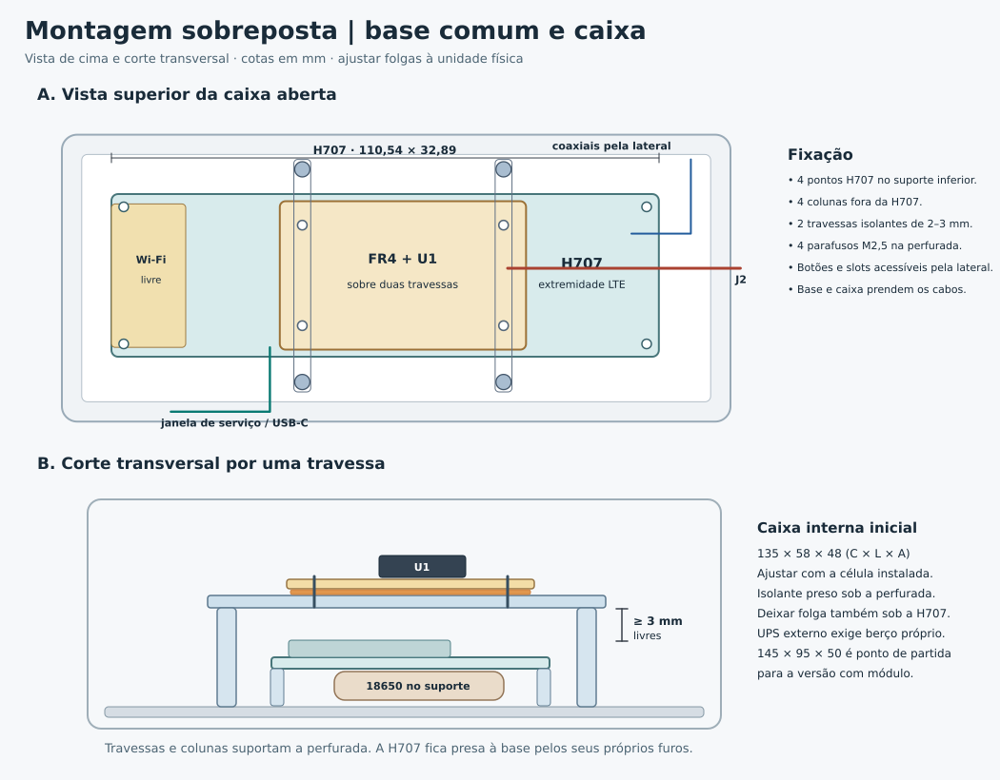

# Fixação e montagem em caixa

As cotas de referência da H707 são 110,54 × 32,89 mm no desenho do fabricante, furos Ø2,0 mm nominal e entre centros de 105,59 × 27,71 mm. A peça física e o plugue usados definem as folgas finais. O comprimento de 50 mm da perfurada favorece uma base comum com travessas. [Desenho cotado LILYGO](https://github.com/Xinyuan-LILYGO/LilyGo-Modem-Series/blob/main/dimensions/esp32s3/T-SIM7670G-ESP32S3.png) · [DXF oficial](https://github.com/Xinyuan-LILYGO/LilyGo-Modem-Series/blob/main/dimensions/esp32s3/T-SIM7670G-S3.dxf)

1. Recorte a base isolante rígida de aproximadamente 127 × 50 × 3 mm. Use o contorno da H707 para transferir os quatro centros. Prenda a H707 pelos furos originais com espaçadores de nylon, parafusos M2 e arruelas. Ajuste a altura inferior ao porta-18650, à troca da célula e aos componentes. Use acesso pela tampa ou suporte removível que mantenha os cabos presos à base.
2. Considere o eixo X a partir da ponta da antena Wi‑Fi. Comece com a perfurada entre X = 34 e 83,7 mm, centrada na largura. Prenda duas travessas isolantes em X ≈ 38,5 e 79,2 mm com as quatro colunas de nylon do lado de fora da H707. Na orientação da figura, comece com centros de coluna em Y = −5 e 38 mm a partir da borda da H707. Afaste ou desloque as travessas em conjunto se bloquearem USB, cartão, botões ou antena. A perfurada deve continuar sobreposta.
3. Fixe a perfurada nas travessas pelos quatro furos B02/B18/J02/J18. Use arruelas e porcas autotravantes compatíveis com nylon. Retire a placa com quatro parafusos sem forçar o chicote. Ajuste as alturas com os conectores instalados. Deixe pelo menos 3 mm de folga real entre soldas/isolante, perfurada/travessas e qualquer componente, plugue ou metal sob elas.
4. Instale lâmina rígida ou flexível de poliéster isolante de cerca de 0,25–0,5 mm sob a perfurada, presa às travessas ou espaçadores. Ela deve cobrir pernas e emendas sem pressioná-las. Mantenha também a face inferior da H707 afastada de qualquer fixação condutora. Inspecione a placa contra luz e meça continuidade após apertar.
5. Posicione a janela de USB-C, o acesso ao microSD, e a inserção do Nano SIM com uma placa real, incluindo a folga para segurar o cartão. Preserve espaço para BOOT, RST, SIM-BOOT, PWR, chave da bateria e IPEX. Deixe pelo menos 15 mm livres de metal e chicotes na região da antena Wi‑Fi. Oriente antenas LTE e GNSS conforme a LILYGO e faça alívio de tração dos coaxiais antes dos IPEX.
6. Use conectores com trava. O J1 pode sair de quatro rabichos soldados e isolados no U5, com laço de serviço curto e retenção na base. Termine A/B em par torcido. Ancore o chicote do caminhão e cabo USB próximo à entrada da caixa para que o conector não suporte a vibração. Pinos, soldas e IPEX ficam livres da carga mecânica. Evite conectores Dupont soltos.
7. Confira a caixa com tampa colocada. A medida interna inicial é 135 × 58 × 48 mm com o porta-célula nativo. Ajuste a altura à célula real e aos cabos. Use caixa ABS/PC, fixada ao veículo em região seca e protegida do calor. Para a rota com UPS, preveja um berço próprio para o módulo de 65 × 30 mm e para a 18650 fora da H707. Uma caixa de 145 × 95 × 50 mm é ponto de partida para esse arranjo. Faça primeiro um gabarito em papel com as peças.

Inspecione travas, parafusos, folgas e continuidade antes e depois da verificação mecânica de bancada. Use o [roteiro de bancada](TESTES_BANCADA.md) para registrar a montagem que será instalada.
